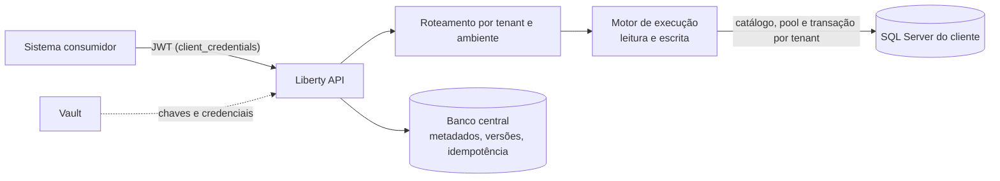

# Liberty

[](https://github.com/rbiasibetti/Liberty/actions/workflows/ci.yml)
[](https://github.com/rbiasibetti/Liberty/actions/workflows/codeql.yml)
[](LICENSE)

**Plataforma multitenant de integração orientada a metadados.** Configure endpoints REST sobre o SQL Server de cada cliente, publique sem deploy e execute com isolamento, auditoria e segurança de ponta a ponta.

Em vez de escrever e implantar código para cada integração, você descreve a integração como metadados (rota, parâmetros, tabelas, mapeamento de JSON para colunas, regras) e a plataforma a publica como uma API pronta para os sistemas consumidores.

## Sumário

- [Principais recursos](#principais-recursos)
- [Como funciona](#como-funciona)
- [Exemplo de uso](#exemplo-de-uso)
- [Segurança](#segurança)
- [Tecnologias](#tecnologias)
- [Primeiros passos](#primeiros-passos)
- [Configuração](#configuração)
- [Estrutura do repositório](#estrutura-do-repositório)
- [Testes e qualidade](#testes-e-qualidade)
- [Status e roteiro](#status-e-roteiro)
- [Documentação](#documentação)
- [Contribuição](#contribuição)
- [Licença](#licença)

## Principais recursos

- **Multitenant de verdade:** o tenant e o ambiente (HML ou PRD) vêm exclusivamente do token JWT; cada cliente tem seu próprio banco, pool de conexões e credenciais em cofre.
- **Leitura declarativa:** `SELECT` paginado com filtros (`=`, `<>`, `>`, `>=`, `<`, `<=`, `LIKE_PREFIX`, `IN`, `BETWEEN`), ordenação controlada, página estável e registros únicos.
- **Escrita transacional em árvore:** INSERT, UPSERT e UPDATE com master-detail de até 5 níveis numa única transação; qualquer falha desfaz a árvore inteira.
- **Idempotência:** o cabeçalho `Idempotency-Key` garante que repetir uma requisição não duplica dados e devolve a resposta original.
- **Snapshots imutáveis:** cada versão publicada de uma integração é um documento JSON imutável, validado por JSON Schema e identificado por hash SHA-256 canônico.
- **SQL seguro por construção:** identificadores vêm do catálogo do banco do cliente, nunca da requisição; todo valor vai como parâmetro tipado; o usuário do banco do tenant não tem DELETE nem DDL.
- **Erros padronizados:** `application/problem+json` (RFC 9457) com violações por campo e `X-Request-Id` em toda resposta, sem vazar detalhes do banco.
- **Pronto para operar:** manifestos Kubernetes, ambiente local completo com um comando, métricas, cenários de carga k6 e esteira de CI com CodeQL e varredura de segredos.

## Como funciona



1. O integrador cadastra a integração (rota, método, parâmetros, mapeamento) no banco central.
2. A versão publicada vira um **snapshot** imutável, associado a um tenant e a um ambiente.
3. O consumidor obtém um token e chama `/{tenant}/api/{rota}`; a plataforma resolve a rota entre as publicações ativas (atualizadas a cada 5 s em todas as instâncias), confere o escopo `integration:execute:<chave>` e executa.
4. A execução valida a entrada, resolve as tabelas no catálogo do tenant e roda o SQL em transação no banco do cliente, com prazo.

## Exemplo de uso

Obter um token (válido por 15 minutos):

```bash
curl -s -X POST http://localhost:8080/oauth2/token \
  -u "$CLIENT_ID:$CLIENT_SECRET" \
  -d grant_type=client_credentials
```

Leitura com filtro, ordenação e paginação:

```bash
curl -s "http://localhost:8080/acme/api/pedidos?cliente=2&sort=-vl_total&limit=20" \
  -H "Authorization: Bearer $TOKEN"
```

```json
{
  "items": [{ "id": 25, "nr_pedido": "P-0025", "vl_total": 250.50 }],
  "page": { "limit": 20, "offset": 0, "returned": 1, "hasMore": false }
}
```

Escrita master-detail (pedido, itens e lotes numa única transação), com idempotência:

```bash
curl -s -X POST http://localhost:8080/acme/api/pedidos \
  -H "Authorization: Bearer $TOKEN" \
  -H "Content-Type: application/json" \
  -H "Idempotency-Key: pedido-2026-0001" \
  -d '{
        "numero": "P-0001", "clienteId": 7, "total": 150.75,
        "itens": [
          { "produto": "A", "qtd": 2, "valor": 10.50, "lotes": [{ "codigo": "L1" }, { "codigo": "L2" }] },
          { "produto": "B", "qtd": 1, "valor": 99.99 }
        ]
      }'
```

```json
{ "key": { "id": 16 }, "rows": { "tb_pedido": 1, "tb_item": 2, "tb_lote": 2 } }
```

Repetir a mesma chave com o mesmo corpo devolve a resposta original (cabeçalho `Idempotent-Replayed: true`) sem gravar de novo. O contrato completo, com erros e códigos de status, está em [docs/api-execucao.md](docs/api-execucao.md).

## Segurança

Nenhum segredo vai para o Git, e os princípios abaixo são obrigatórios no produto:

- O tenant vem **somente** do JWT (RS256, 15 minutos); chaves de assinatura ficam no Vault, com rotação automática e janela de transição; o JWKS expõe só a parte pública.
- Cada endpoint exige autorização explícita (`@PreAuthorize`), verificada por teste de arquitetura; CORS por lista de permissão.
- Segredos só em cofre; nenhum dado pessoal em log; mensagens de erro nunca repetem valores recebidos.
- SQL com identificadores validados contra o catálogo e valores sempre parametrizados; corpo de requisição com limites rígidos (tamanho, profundidade, itens por lista, chaves duplicadas).
- Scripts de integradores rodam em processos isolados, com memória e prazo limitados, sem acesso a classes Java, arquivos ou rede.

Para reportar uma vulnerabilidade, veja [SECURITY.md](SECURITY.md).

## Tecnologias

| Camada | Stack |
| --- | --- |
| Backend | Java 25, Spring Boot 4, Spring Security e Authorization Server, Spring Data JPA, Flyway, HikariCP, Caffeine |
| Banco | SQL Server (banco central e um banco por cliente) |
| Segredos e identidade | HashiCorp Vault (KV v2), JOSE/JWT, OIDC para usuários |
| Frontend | React 19, TypeScript, Vite, Vitest |
| Qualidade | JUnit 5, Testcontainers, ArchUnit, JaCoCo (80%), PIT, Checkstyle, Spotless, ESLint, Prettier |
| Operação | Docker Compose, Kubernetes, Prometheus, Grafana, Jaeger, k6, GitHub Actions (CI), CodeQL |

## Primeiros passos

### Pré-requisitos

- JDK 25 (o wrapper baixa o Maven 3.9)
- Node.js 20.19 ou superior (22 LTS recomendado) e npm
- Docker Compose ou Podman (para o ambiente local completo)
- SQL Server acessível para os testes de banco (ou Docker, via Testcontainers)

### Ambiente local

```bash
git clone https://github.com/rbiasibetti/Liberty.git
cd Liberty
make setup       # ativa os hooks de commit (Conventional Commits)
make local-up    # sobe Redis, Vault, Keycloak, Prometheus, Grafana e Jaeger e prepara os bancos
make migrate-core
```

O `make local-up` escuta só em `127.0.0.1`, gera as senhas que faltarem em `.env.local` (ignorado pelo Git) e prepara os bancos `liberty_core`, `tenant_cliente_a` e `tenant_cliente_b` com tabelas de exemplo. Se já houver um SQL Server em `LIBERTY_TEST_DB_HOST:LIBERTY_TEST_DB_PORT`, ele é reaproveitado.

### Executar

```bash
cd backend && ./mvnw -pl liberty-app spring-boot:run     # API em http://localhost:8080
cd frontend && npm install && npm run dev                # interface web
```

Sem Vault, `LIBERTY_SECURITY_KEYS_STORE=MEMORY` gera chaves só em memória (apenas desenvolvimento).

### Comandos úteis

```bash
make verify        # formatação, lint, testes, cobertura e build do backend e do frontend
make format        # aplica Spotless e Prettier
make mutation      # testes de mutação do backend (lento)
make local-down    # derruba o ambiente local
```

## Configuração

| Variável | Para que serve |
| --- | --- |
| `LIBERTY_CORE_URL`, `LIBERTY_CORE_APP_USER`, `LIBERTY_CORE_APP_PASSWORD` | Banco central |
| `LIBERTY_VAULT_URI`, `LIBERTY_VAULT_TOKEN` | Cofre de segredos e chaves de assinatura |
| `LIBERTY_SECURITY_ISSUER` | Emissor dos tokens de sistema (ex.: `http://127.0.0.1:8080`) |
| `LIBERTY_OIDC_ISSUER` | Provedor OIDC dos usuários (ex.: Keycloak) |
| `LIBERTY_SECURITY_KEYS_STORE` | `MEMORY` apenas em desenvolvimento e testes |
| `LIBERTY_TEST_DB_HOST`, `_PORT`, `_USER`, `_PASSWORD` | SQL Server usado pelos testes de banco |

Os nomes completos estão em [`.env.example`](.env.example); copie para `.env.local` e preencha. Os ajustes do motor ficam em `liberty.engine.*` (prazos de consulta e de escrita, limite de linhas por requisição, validade da idempotência).

## Estrutura do repositório

| Pasta | Conteúdo |
| --- | --- |
| `backend/` | Maven multi-módulo: `liberty-domain` (Java puro), `liberty-core-migrations` (Flyway do banco central), `liberty-snapshot` (modelo, validação e hash do snapshot, sem Spring), `liberty-engine` (roteamento e execução de leitura e escrita), `liberty-infrastructure` (JPA, tenancy, catálogo, segurança) e `liberty-app` (Spring Boot) |
| `frontend/` | React + TypeScript + Vite |
| `deploy/` | Docker Compose local e manifestos Kubernetes |
| `docs/` | ADRs, requisitos não funcionais e contrato da API |
| `loadtest/` | Cenários k6 de carga (rodam manualmente) |
| `scripts/` | Preparação do ambiente local e dos bancos de exemplo |

Provas de conceito descartáveis ficam em `backend/poc` e só entram no build com `-Ppoc`.

## Testes e qualidade

```bash
make verify
```

- Testes de unidade, de banco (SQL Server real) e de contrato HTTP de ponta a ponta, incluindo fuzzing de parâmetros e testes de falha com desfazimento de transação.
- Testes de arquitetura (ArchUnit) garantem as fronteiras entre módulos e que todo endpoint é protegido.
- Cobertura mínima de 80% de linhas por módulo; testes de mutação (PIT) no perfil `mutation`.
- A esteira de CI executa build, testes, análise estática (CodeQL) e varredura de segredos. Requisitos e SLOs: [docs/requisitos-nao-funcionais.md](docs/requisitos-nao-funcionais.md).

## Status e roteiro

O projeto está em desenvolvimento ativo, etapa por etapa.

- [x] Estrutura do monorepo, CI/CD, ambiente local e requisitos não funcionais
- [x] Banco central, tenancy em tempo de execução, autenticação e autorização
- [x] Catálogo do tenant, modelo do snapshot e validação
- [x] Motor de leitura e roteamento
- [x] Motor de escrita (master-detail transacional, UPSERT, UPDATE) e idempotência
- [x] Funções de transformação de campos e motor de scripts JavaScript isolados
- [ ] Ciclo de vida das integrações (rascunho, revisão, publicação, reversão)
- [ ] Auditoria, observabilidade e proteção de tráfego (limites de taxa)
- [ ] Interface web de administração e testes de ponta a ponta
- [ ] Fase 2 (recursos avançados)

## Documentação

- [Registros de decisão de arquitetura (ADRs)](docs/adr/README.md)
- [API de execução](docs/api-execucao.md)
- [Requisitos não funcionais e SLOs](docs/requisitos-nao-funcionais.md)

## Contribuição

Contribuições são bem-vindas. Leia [CONTRIBUTING.md](CONTRIBUTING.md) antes de abrir um pull request; os commits seguem o padrão [Conventional Commits](https://www.conventionalcommits.org/pt-br/).

## Licença

Distribuído sob a licença MIT. Veja [LICENSE](LICENSE).
